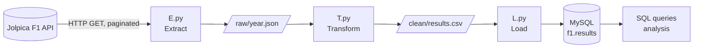
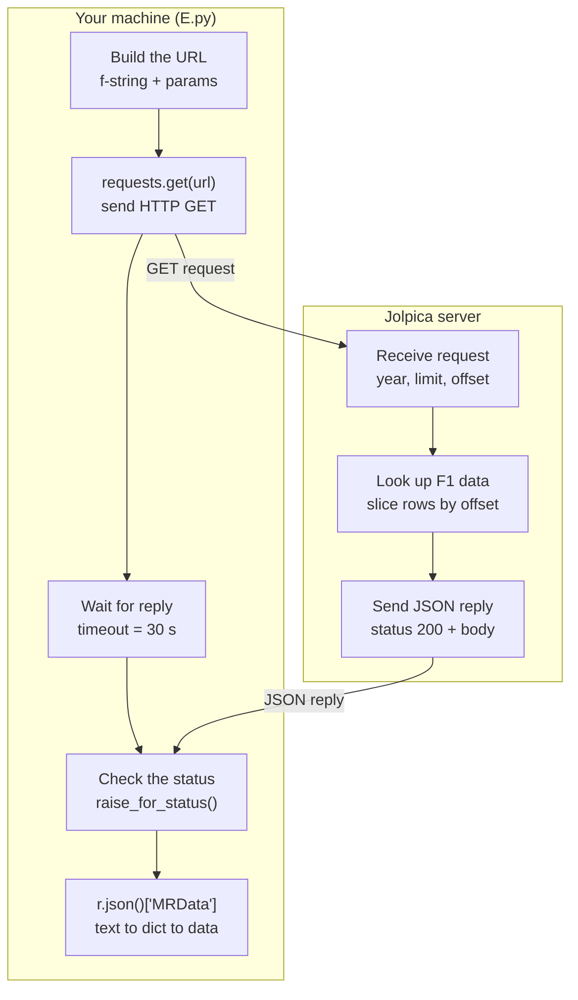
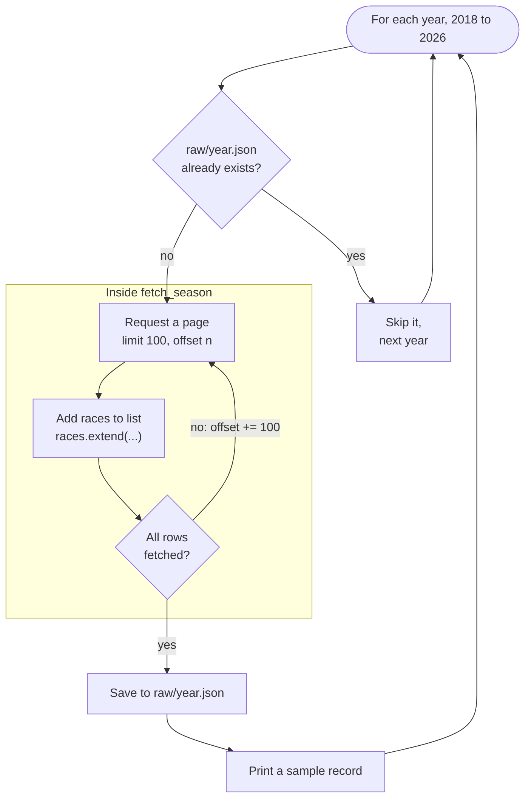

# F1 Pit Wall: ETL Pipeline & SQL Analytics

An end-to-end batch ETL pipeline that pulls Formula 1 race results (2018-2026) from a public REST API, cleans them with Pandas, loads them into a **MySQL** database, and answers racing questions with SQL.

**Stack:** Python · Requests · Pandas · SQLAlchemy · PyMySQL · MySQL

---

## What this project does

1. **Extract** race results season by season from the [Jolpica F1 API](https://api.jolpi.ca/ergast/f1/) (free, no API key), handling pagination and saving every raw response to disk.
2. **Transform** the nested JSON into one flat table: typed columns, duplicates removed, sanity checks printed.
3. **Load** the clean table into a MySQL database.
4. **Analyse** the data with SQL (CTEs, a `RANK()` window function and grouped aggregations): constructor dominance, driver wins and podiums, pole-to-win conversion, retirements and season-to-season driver improvement.

---

## Architecture



Each stage hands its output to the next one **on disk**, so a failed step can be re-run on its own without repeating the earlier ones.

| Step | File | Input | Output |
|---|---|---|---|
| Extract | `pipeline/E.py` | Jolpica API | `raw/{year}.json` |
| Transform | `pipeline/T.py` | `raw/*.json` | `clean/results.csv` |
| Load | `pipeline/L.py` | `clean/results.csv` | MySQL table `f1.results` |
| Analyse | MySQL queries | `f1.results` | Query results (`results/`) |

---

## Extraction in detail

### How one API call works



| Part | Value |
|---|---|
| Method | `GET` |
| Endpoint | `https://api.jolpi.ca/ergast/f1/{year}/results.json` |
| Auth | None |
| `limit` | `100` rows per page |
| `offset` | `0, 100, 200, ...` rows to skip |
| Timeout | 30 seconds |

Shape of the response (only the parts the pipeline uses):

```
MRData
├── total        total result rows for the season (used to stop paging)
└── RaceTable
    └── Races[]              one object per race
        ├── season, round, raceName, date
        └── Results[]        one object per driver
            ├── Driver       givenName, familyName
            ├── Constructor  name
            └── grid, position, positionText, points, status
```

### How the season loop works

The API returns at most 100 rows per call, so each season takes several calls. The outer loop goes over years, and `fetch_season` repeats the single call above with a growing `offset` until every row has been collected.



### Reliability measures

- `raise_for_status()` stops the run on any HTTP error (404, 429, 500) instead of saving bad data.
- `timeout=30` prevents the script hanging on a dead connection.
- `time.sleep(1)` between pages keeps the free API from being hammered.
- Each season is saved to `raw/{year}.json` and **skipped if it already exists**, so a crashed run resumes where it stopped and the API is never called twice for the same season.

---

## Transform

`T.py` flattens the nested JSON (race, then each driver's result inside that race) into one row per driver per race, then:

- converts types (`int` for season, round, grid and position; `float` for points; `datetime` for the race date),
- drops duplicates on `(season, round, driver)`, since a race can straddle two API pages and appear twice,
- prints sanity checks: table shape, nulls per column and rows per season.

The result is saved to `clean/results.csv`.

### Table: `f1.results`

| Column | Type | Meaning |
|---|---|---|
| `season` | int | Championship year |
| `round` | int | Race number within the season |
| `race_name` | text | Grand Prix name |
| `race_date` | datetime | Date of the race |
| `driver` | text | Full driver name |
| `constructor` | text | Team name |
| `grid` | int | Starting position (`0` = pit-lane start) |
| `position` | int | Official finishing position |
| `position_text` | text | Finishing position as text (`R` = retired) |
| `points` | float | Points scored in the race |
| `status` | text | Finished, or the reason the car stopped |

The natural key is `(season, round, driver)`: a driver has at most one result per race.

---

## Load

`L.py` reads `clean/results.csv` and writes it to the `results` table in the `f1` MySQL database with `DataFrame.to_sql()` through SQLAlchemy and PyMySQL. It then runs `SELECT COUNT(*)` against MySQL and prints the count, so the loaded row count can be compared with the CSV.

---

## SQL analysis

Five questions answered in MySQL against `f1.results`. The SQL for each is collapsed under its question, and the analysis output is in the `results/` folder.

### 1. Which constructor scored the most points each season?

**Approach:** total points per team per season in a CTE, then `RANK()` over each season to keep the top team.

<details>
<summary>View SQL</summary>

```sql
-- Best Constructor Each Season
USE f1;
WITH t AS (
  SELECT season, constructor, SUM(points) AS pts
  FROM results GROUP BY season, constructor
)
SELECT season, constructor, pts FROM (
  SELECT *, RANK() OVER (PARTITION BY season ORDER BY pts DESC) AS rnk FROM t
) x WHERE rnk = 1 ORDER BY season;
```

</details>

**Result:**

| Season | Constructor | Points |
|---|---|---|
| 2018 | Mercedes | 655 |
| 2019 | Mercedes | 739 |
| 2020 | Mercedes | 573 |
| 2021 | Mercedes | 604.5 |
| 2022 | Red Bull | 724 |
| 2023 | Red Bull | 790 |
| 2024 | McLaren | 609 |
| 2025 | McLaren | 775 |
| 2026 | Mercedes | 565 (season in progress) |

Mercedes topped the table for four straight seasons, then Red Bull for two and McLaren for two. The `.5` in 2021 comes from the half points awarded at the shortened Belgian Grand Prix. Sprint points are not included (see limitations).

### 2. Which drivers have the most wins and podiums?

**Approach:** in MySQL a comparison like `position = 1` evaluates to 1 or 0, so `SUM(...)` counts the rows where it is true. Group by driver and sort by wins.

<details>
<summary>View SQL</summary>

```sql
-- Which Driver Has The Most Wins & Podiums
USE f1;
SELECT driver,
    SUM(position = 1)  AS wins,
    SUM(position <= 3) AS podiums,
    COUNT(*)           AS races
FROM results
GROUP BY driver
ORDER BY wins DESC, podiums DESC
LIMIT 10;
```

</details>

**Result (2018 to 2026, 2026 still in progress):**

| Driver | Wins | Podiums | Races |
|---|---|---|---|
| Max Verstappen | 71 | 127 | 192 |
| Lewis Hamilton | 44 | 92 | 191 |
| Lando Norris | 13 | 49 | 171 |
| Charles Leclerc | 9 | 56 | 192 |
| Oscar Piastri | 9 | 28 | 89 |
| Andrea Kimi Antonelli | 9 | 19 | 43 |
| George Russell | 8 | 32 | 171 |
| Valtteri Bottas | 7 | 45 | 168 |
| Sergio Pérez | 6 | 32 | 166 |
| Sebastian Vettel | 6 | 23 | 101 |

Verstappen leads with 71 wins and 127 podiums in 192 races, well ahead of Hamilton.

### 3. How often does the pole sitter win each season?

**Approach:** the pole sitter is the driver with `grid = 1`. For each season, count the poles and how many of them turned into wins, then express that as a percentage.

<details>
<summary>View SQL</summary>

```sql
-- How Often Does A Pole Sitter Win Each Season
USE f1;
SELECT season,
       COUNT(*) AS poles,
       SUM(position = 1) AS pole_wins,
       ROUND(100 * SUM(position = 1) / COUNT(*), 1) AS pole_win_pct
FROM results
WHERE grid = 1
GROUP BY season
ORDER BY season;
```

</details>

**Result:** _[paste the season rows from Workbench here after running the query above]_

### 4. Which constructors retire from races the most?

**Approach:** keep only rows whose `status` is `Retired`, then count them per constructor.

<details>
<summary>View SQL</summary>

```sql
-- Which Constructors Retire From Races The Most
USE f1;
SELECT constructor, COUNT(*) AS retired
FROM results
WHERE status = 'Retired'
GROUP BY constructor
ORDER BY retired DESC;
```

</details>

**Result (top 5 of 14 constructors):**

| Constructor | Retirements |
|---|---|
| Williams | 39 |
| Aston Martin | 35 |
| Haas F1 Team | 24 |
| Alpine F1 Team | 24 |
| Red Bull | 17 |

These are raw counts, not rates, and only rows with the status `Retired` are counted (see limitations).

### 5. Which drivers improved the most from the previous season?

**Approach:** total points per driver per season in a CTE, then join that table to itself so each driver-season is matched with the same driver's previous season. The difference is the improvement. The unfinished 2026 season is excluded.

<details>
<summary>View SQL</summary>

```sql
-- Which Drivers Improved The Most From The Previous Season
USE f1;
WITH season_points AS (
    SELECT driver, season, SUM(points) AS pts
    FROM results
    WHERE season < 2026
    GROUP BY driver, season
)
SELECT cur.driver,
       cur.season,
       prev.pts AS prev_pts,
       cur.pts  AS pts,
       cur.pts - prev.pts AS change_vs_prev
FROM season_points cur
JOIN season_points prev
  ON cur.driver = prev.driver
 AND cur.season = prev.season + 1
ORDER BY change_vs_prev DESC
LIMIT 10;
```

</details>

**Result:** _[paste the top rows from Workbench here after running the query above]_

---

## Getting started

### Prerequisites

- Python 3.10+
- MySQL Server 8.x running locally (MySQL Workbench optional)

### Setup

```bash
git clone https://github.com/NAV-ON-WINDOWS/f1-DA.git
cd f1-DA

python -m venv venv
venv\Scripts\activate        # Windows
pip install requests pandas sqlalchemy pymysql cryptography python-dotenv
```

Create the database once, in MySQL Workbench or the MySQL command line:

```sql
CREATE DATABASE f1;
```

Create a `.env` file in the project folder:

```
MYSQL_PASSWORD=your_mysql_root_password
```

### Run the pipeline

```bash
py pipeline/E.py     # 1. Extract: API -> raw/*.json
py pipeline/T.py     # 2. Transform: raw/*.json -> clean/results.csv
py pipeline/L.py     # 3. Load: clean/results.csv -> MySQL f1.results
```

Run the commands from the repository root so `raw/` and `clean/` are created there. Then verify in MySQL:

```sql
USE f1;
SELECT season, COUNT(*) AS result_rows, COUNT(DISTINCT round) AS races
FROM results GROUP BY season ORDER BY season;
```

`raw/` is created when you run the extract step and is not committed. `clean/results.csv` is included in the repo, so you can skip straight to the load step if you only want the database.

---

## Project structure

```
f1-DA/
├── pipeline/       # ETL scripts: extract (E.py), transform (T.py), load (L.py)
├── clean/          # Cleaned CSV produced by the transform step
├── results/        # Analysis results
├── .env            # Database password (not committed)
├── .gitignore
└── README.md
```

---

## Known limitations

- **Sprint-race points** come from a separate API endpoint and are not included, so season point totals can be slightly lower than the official standings.
- **2026 is an unfinished season**, so its numbers (including totals in questions 1, 2 and 4) are partial and will change as races are added.
- **Retirements** are counted as rows with `status = 'Retired'` only. Other non-finishing statuses (specific failures, collisions, disqualifications) are not included, and the result is a raw count, not a rate, so teams with fewer seasons are not directly comparable.
- **Rebranded teams** appear under separate names (for example AlphaTauri / RB F1 Team, or Alfa Romeo / Sauber / Audi), so their figures are split across names.
- **Full reload:** the load step replaces the whole table on every run instead of adding only new rows.
- **Manual runs:** the three scripts are run by hand; there is no scheduler or alerting.

## Roadmap

- Incremental loads with a primary key and `INSERT ... ON DUPLICATE KEY UPDATE`
- Retirement **rate** per constructor using every non-finishing status, instead of raw counts
- Automated data-quality checks (row counts, nulls, impossible values)
- A single entry point that runs all three stages with logging
- A podium-prediction model built on features pulled from MySQL

---

## Data source

Race data comes from the community-maintained [Jolpica F1 API](https://api.jolpi.ca/ergast/f1/), an Ergast-compatible service. All data belongs to its respective sources.

## Author

**Arnav Salgarkar**: [GitHub](https://github.com/NAV-ON-WINDOWS) · [LinkedIn](https://linkedin.com/in/arnavsalgarkar)
